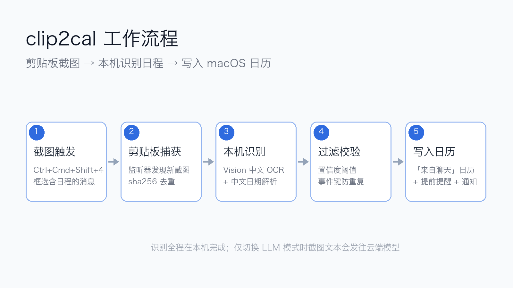

# SnapCalendar — 剪贴板截图 → 日历日程

按下系统截图快捷键框选一条带日程的消息（微信 / QQ / 邮件 / 网页都行），它自动识别出其中的日程安排并写进 macOS 日历的「来自聊天」日历，同时弹通知播报。



## 快速开始

1. 双击 `grant_and_run.command`（首次会弹日历授权，点「允许」，之后不再问）
2. 看到通知「已启动」即就绪
3. 按 **⌥S**（Option+S）框选含日程的内容 → 自动识别 → 写入「来自聊天」日历；原生 **Ctrl+Cmd+Shift+4** 也随时可用

> 也可以在终端运行：`cd SnapCalendar && ./run.sh`
> 停止：在终端窗口按 `Ctrl+C`，或直接关窗口

## 全局快捷键与开机自启

- **快捷键**：默认 `⌥S`（两键），在 `config.local.json` 里改 `"hotkey"`，格式 `修饰键+字母`，如 `"cmd+shift+a"`、`"ctrl+q"`（至少一个修饰键，避免吞掉正常打字）。首次按 ⌥S 需两次授权：①系统会请求「辅助功能」（在设置里打开「终端」开关，无需重启）；②弹「终端想录制屏幕」点允许——若截到的图只有壁纸，退出终端重新双击 `grant_and_run.command` 一次即可
- **开机自启**：首次运行 `grant_and_run.command` 时自动把本脚本注册为登录项（首次会弹「终端想控制系统事件」，点允许）。开机后自动进入监控状态；移除：系统设置 → 通用 → 登录项与扩展 → 删除 SnapCalendar

## 语义识别能力（v2）

- **跨子句关联**：任务和时间不挨着也能配对——"小刘，把季度总结的PPT改一版，重点突出Q3数据。周四上午十点前发到我邮箱。" → 事件《截止：季度总结的PPT改一版》10月15日 10:00（任务标题自动回溯前文，备注标注语义关联）
- **中文数字时间**：十点半 / 两点一刻 / 今晚八点 全部支持
- **截止语义**："周五前发我" → 截止型日程，时间即截止时刻（标题加"截止："前缀）
- **称呼/客套清理**：自动去掉"王总：""另外""麻烦""请准时参加"等非任务成分
- **全天事件**：只有日期没时刻（"下周一交月报"）→ 全天日程
- **防误报**：纯"今天/明天"无任务语境的闲聊不建日程

## 识别分层（extractor 模式）

| 模式 | 说明 |
|---|---|
| `llm`（当前） | **LLM 语义识别**：Vision OCR 取文本 → LLM 理解任务与时间（跨句关联、截止语义、模糊表述过滤都在提示词里）→ 结构化 JSON。任意 OpenAI 兼容接口可用；启动时探活，失败自动回退规则引擎 |
| `auto` | 端侧模型（Apple Foundation Models，免 key）优先，不可用回退规则引擎 |
| `apple` | 仅端侧模型 |
| `local` | 仅规则引擎（Vision OCR + 中文语义解析，确定性最好、零依赖） |

### 如何启用 LLM 识别

`config.json` 里三选一：

1. **Z.ai / 智谱开放平台 key**（推荐，和系统同源）：到 https://z.ai 或 https://bigmodel.cn 创建 API Key，填入 `"api_key"`，`"api_base"` 填 `https://api.z.ai/api/paas/v4`；想免费用把 models 换成 `["glm-4v-flash"]`（免费视觉模型）
2. **任意 OpenAI 兼容服务**：DeepSeek / 通义 / Kimi / 阿里云百炼 / 自建 Ollama 等，填 `api_base` + `api_key` + `models`（文本模型即可，因为输入是 OCR 文本）。百炼注意分站：国内站 `dashscope.aliyuncs.com`、国际站 `dashscope-intl.aliyuncs.com`，key 只认各自域名（本机当前用国际站 + qwen-plus）
3. **不填**：`api_key_file` 指向的 OpenClaw 配置里若有直连 key 会自动解析（本机当前没有，所以需要手动填）

填好后双击 `grant_and_run.command` 重启，日志出现「LLM 通道就绪」即生效；探活失败会写明原因并回退规则引擎。

> 端侧模型要求：Apple Intelligence 已开启且硬件支持（本机当前 deviceNotEligible）。
> 隐私提示：`llm` 模式会把截图 OCR 文本发给对应模型服务；`local`/`auto` 全程本机。

## 配置（config.local.json）

复制 `config.example.json` 为 `config.local.json` 再填入你的 key——**config.local.json 已被 .gitignore 排除，不会进仓库**。

| 字段 | 默认 | 说明 |
|---|---|---|
| `extractor` | `llm` | 识别模式，见上表 |
| `api_base` / `api_key` | 空 | LLM 接入点与密钥（OpenAI 兼容格式） |
| `api_key_file` / `api_key_provider_hint` | OpenClaw 配置 / zai | 备用：从本地配置文件自动解析直连 key |
| `models` | glm 系列 | 依次尝试的模型列表 |
| `calendar_name` | `来自聊天` | 事件写入的独立日历，不存在会自动创建 |
| `alarm_minutes` | `15` | 提前提醒分钟数，`0` 为不加提醒 |
| `poll_interval` | `2` | 剪贴板轮询间隔（秒） |
| `confidence_min` | `0.5` | 低于该置信度的候选不入日历 |

> 安全：真实 key 只存在本机 `config.local.json`（不入库）；仓库里只有占位模板。运行数据 `state/`（含消息 OCR 内容）同样不入库。

## 文件结构

```
SnapCalendar/
├── snapcalendar.py            主程序（监控 + OCR + 语义解析 + 写日历）
├── fm_extract.swift       端侧模型抽取器源码（Apple Foundation Models）
├── grant_and_run.command  双击：授权 + 自测 + 启动
├── run.sh                 终端启动（已授权后用）
├── config.example.json    配置模板（复制为 config.local.json 后填 key）
├── config.local.json      本地真实配置（不入库，含 key）
├── state/                 运行数据（不入库：日志 / 识别流水 / 去重记录）
├── tests/                 单测（解析器边界、语义关联、OCR 链路、自测、流程图）
├── assets/flow.png        工作流程图
└── com.jynnai.snapcalendar.plist  开机自启模板（默认未安装）
```

> `fm_extract` 为 fm_extract.swift 的编译产物（swiftc -O -parse-as-library fm_extract.swift -o fm_extract），auto 模式自动调用，不入库。

## 常见问题

- **授权弹窗归属**：从哪个终端/应用启动，授权就绑定谁。用 `grant_and_run.command`（Terminal）授权一次后，同一入口启动不再询问
- **重复截图**：同一张图不会重复处理（哈希去重）
- **没识别到日程**：弹通知说明，不会乱写日历
- **端侧模型报 unavailable**：未开启 Apple Intelligence 或硬件不支持，会自动回退规则引擎，不影响使用

## 已知限制

- 规则引擎对"下周找个时间碰一下"这类模糊表述按设计跳过（避免编造日程）
- 日期与时刻分在相隔很远的两段时（中间隔 3 句以上）可能配不上
- 图片/语音消息的日程无法识别（截图里得有文字）

## 后续路线

- 开机自启：`cp com.jynnai.snapcalendar.plist ~/Library/LaunchAgents/ && launchctl load -w ~/Library/LaunchAgents/com.jynnai.snapcalendar.plist`（首次会以 python 身份再弹一次授权）
- 菜单栏常驻 + 写入前确认卡（可改可删再存）
- 自定义全局热键触发 `screencapture -i`（不依赖系统快捷键习惯）
